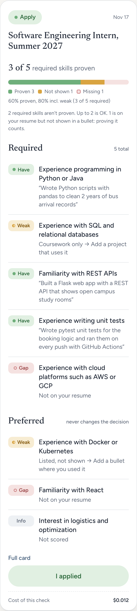
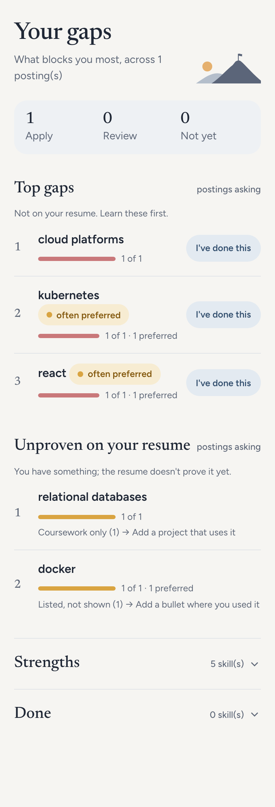
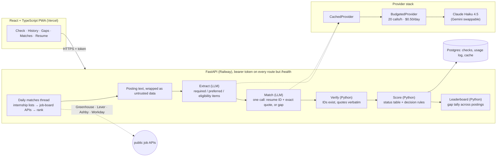

# FitCheck

**An LLM agent that tells a student whether their resume meets an internship posting's bar, cites the exact resume line behind every claim, and tracks which missing skills block them most often.**

<p>
  
  
</p>

<sub>Screenshots use a fictional resume and a synthetic posting. The card is the real output of one Claude Haiku run, saved as a fixture.</sub>

- **The model labels facts; Python makes the decision.** Claude extracts requirements and cites resume evidence. Plain, unit-tested Python applies the apply/don't-apply rules.
- **No invented evidence.** Every "you have this" claim must quote the resume word for word, and code rejects any quote it can't find: **100% evidence validity** on a 9-posting labeled eval.
- **Built to run cheaply in production.** FastAPI + Postgres on Railway and a React PWA on Vercel, at **~$0.017 and ~18 s per posting**, with hard hourly and daily spending limits.

## The problem

I couldn't judge whether my resume fit a posting, so I wasn't applying. For each posting FitCheck answers:

1. **Should I apply?** Yes when at least one required item is proven and I miss at most 2 required items or cover at least 80% of them. Only proven evidence counts.
2. **What exactly is missing?** Every required and preferred item is marked `have` (with the quoted resume line), `weak` (for example, coursework only, or listed but never shown in a bullet), or `gap`. It never edits the resume; I decide.
3. **What should I learn first?** A board across all postings ranks the missing skills that block me most often.

Eligibility (graduation window, degree, work authorization, location) is checked separately and never counted as a skill gap.

## Architecture



| Layer | What's used |
|---|---|
| Model | Claude Haiku 4.5 via the official Anthropic SDK, native structured outputs. Gemini Flash provider built and tested behind the same interface. |
| Backend | Python 3.12, FastAPI, Pydantic, SQLAlchemy (SQLite locally, Postgres in production), uv |
| Frontend | React 19, TypeScript, Vite, installable PWA (manifest, no service worker), self-hosted fonts |
| Resume import | pypdf, python-docx; contact info is stripped in code before any model sees the text |
| Testing | pytest, Vitest, Playwright (demo walkthrough) |
| Hosting | Railway (API + Postgres), Vercel (app) |

## Key decisions and tradeoffs

- **Facts from the model, policy in code.** The model never outputs a status or a score. It returns a quote and a relation, and a status table in `score.py` maps those to `have`/`weak`/`gap`. Thresholds stay deterministic, testable and explainable.
- **Verbatim evidence instead of trusting the model.** `verify.py` rejects any cited resume ID that doesn't exist and any quote that isn't an exact substring of that item. Requirements extracted from the posting get the same verbatim check.
- **Retry once with feedback, then stop.** Invalid output gets one retry with the validator's error message. A second failure returns "review manually" instead of looping, and refusals count as invalid output.
- **One match call per posting**, not one per requirement. That's cheaper, and the model sees the whole resume once.
- **Cost controls are part of the architecture.** Every call goes through a cache (identical requests cost $0) and a budget guard. In production the usage log lives in Postgres, so a redeploy can't reset the limits.
- **A reviewer model was measured, then not built.** A second "recheck every `have`" call was the planned fix for false matches. A prompt rule plus a deterministic duplicate-item check cut false matches from 3 to 1 on the 5-posting set, so an extra call on every posting wasn't worth it ([findings](evals/m7_findings.md)).
- **Privacy by construction.** Contact info lives in a gitignored file and is never sent to a model. Resume import strips emails, phones and links before the model call. Images are refused because code can't strip a phone number from a picture.
- **Posting text is untrusted input.** It's wrapped in delimiters and labeled as data, to defend against prompt injection.

Full rules: [`docs/decision_rules.md`](docs/decision_rules.md).

## Testing and evaluation

| Suite | Result |
|---|---|
| Python (`uv run pytest`) | 473 passed, 5 skipped (opt-in live API tests, optional Gemini extra) in ~7 s, offline, $0 |
| Web (`npm test`) | 47 passed (Vitest) |
| Demo walkthrough (`npm run demo`) | 1 passed (Playwright, fixture-only, fails if any unexpected request leaves the page) |

**LLM eval harness** (`uv run fitcheck eval`) runs labeled postings through the full pipeline and compares the output to a hand-written answer key. Latest run: 9 real postings, Claude Haiku 4.5.

| Metric | Result |
|---|---|
| Requirement extraction recall | 90% |
| Required vs. preferred accuracy | 100% |
| Evidence validity (quotes verbatim, IDs real) | 100% |
| False matches (claims a skill the resume doesn't prove) | 4 of 49 skill items |
| False gaps | 9 of 49 skill items |
| Apply / don't-apply agreement with the label | 7 of 9 |
| Eligibility agreement | 8 of 9 |
| Cost / latency per posting | $0.0167 / 14.0 s |

The labeled postings, their answer keys and the resume they were scored against stay in a private repo, because they contain a real resume and a real job search. `evals/` here holds the rubric, the label template, the [M7 findings](evals/m7_findings.md), and a fictional stand-in resume that the unit tests use.

False matches are tracked separately from false gaps because they're worse: they tell you to apply for something you can't back up. Nine postings is a small set, so these numbers show direction, not proof. One posting is 11 points of decision agreement.

## Demo

- **Walkthrough video:** _link to be added_ (recorded by `npm run demo`; see [`docs/demo/README.md`](docs/demo/README.md)).
- **Screenshots:** [`docs/demo/screenshots/`](docs/demo/screenshots/), covering login, paste a posting, the fit card, the full card, history, gaps and resume.

The demo replays a saved fixture: one real Haiku run ($0.012) on a fictional resume and a synthetic posting. Re-running it never calls the model or the real API.

## Run it locally

Requires [uv](https://docs.astral.sh/uv/) and Node.

```sh
uv sync                     # Python dependencies
uv run pytest               # offline tests, never call the API
cp .env.example .env        # add ANTHROPIC_API_KEY and APP_TOKEN to use the model

cd web && npm install
npm test                    # Vitest
npm run demo                # Playwright walkthrough from the fixture (no keys needed)
```

The CLI: `uv run fitcheck check path/to/posting.txt --resume resume.yaml --profile profile.yaml`.

## Repo map

```
src/fitcheck/        pipeline: extract.py, match.py, verify.py, score.py, pipeline.py
  providers/         provider interface, Anthropic, Gemini, budget guard, cache
  api.py, db.py      FastAPI app and storage
  leaderboard.py     gap tally across postings
  matches.py         daily matches (listings → job-board APIs → rank)
web/src/             React app; api.ts is the only code that calls the API
evals/               rubric, label template, findings; fixtures/ is a fictional test resume
docs/                decision rules, system diagrams, demo assets
tests/               pytest suite
```
